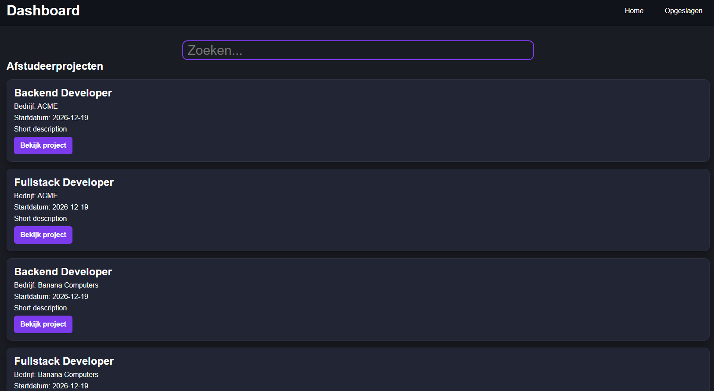
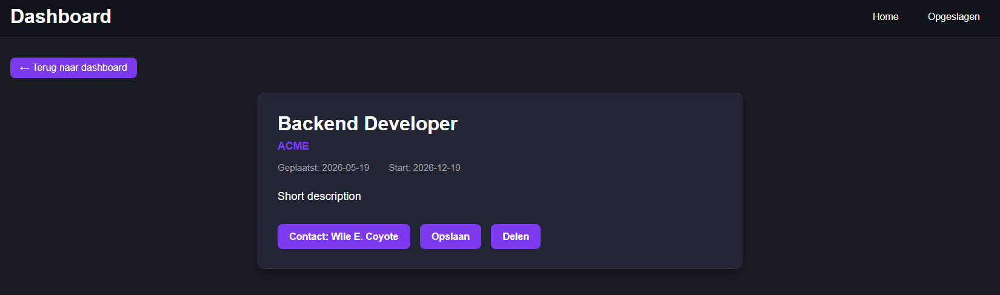
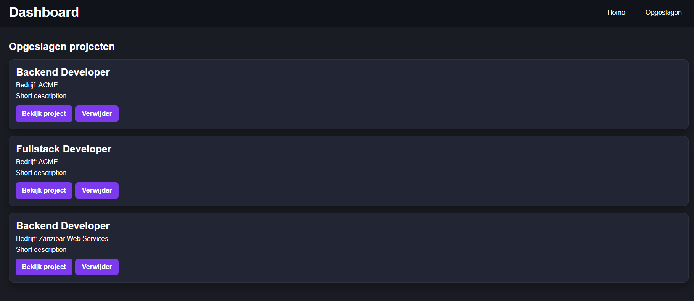

# React + Vite

This template provides a minimal setup to get React working in Vite with HMR and some ESLint rules.

Currently, two official plugins are available:

- [@vitejs/plugin-react](https://github.com/vitejs/vite-plugin-react/blob/main/packages/plugin-react) uses [Oxc](https://oxc.rs)
- [@vitejs/plugin-react-swc](https://github.com/vitejs/vite-plugin-react/blob/main/packages/plugin-react-swc) uses [SWC](https://swc.rs/)

## React Compiler

The React Compiler is enabled on this template. See [this documentation](https://react.dev/learn/react-compiler) for more information.

Note: This will impact Vite dev & build performances.

## Expanding the ESLint configuration

If you are developing a production application, we recommend using TypeScript with type-aware lint rules enabled. Check out the [TS template](https://github.com/vitejs/vite/tree/main/packages/create-vite/template-react-ts) for information on how to integrate TypeScript and [`typescript-eslint`](https://typescript-eslint.io) in your project.

# Installatie + Setup
Volg de onderstaande stappen om de applicatie lokaal te runnen.
1. **Clone de repository:**\
`git clone https://github.com/Rac-Software-Development/wp4-2026-pwa-wp4-2026-pwa-1b6-fox.git`
2. **Ga naar de projectmap:**\
`cd wp4-2026-pwa-wp4-2026-pwa-1b6-fox`
3. **Installeer Docker Desktop:**\
Download en installeer Docker Desktop via:\
https://www.docker.com/products/docker-desktop/
4. **Start Docker Desktop:**\
Controleer of Docker Desktop actief is voordat je de applicatie start.
5. **Installeer de benodigde packages:**\
`npm install`
6. **Start de applicatie:**\
`npm run dev`
7. **Open de applicatie in de browser:**\
Klik op de localhost-link die in de terminal verschijnt, bijvoorbeeld:\
`http://localhost:5173`

# Screenshots
### Dashboard pagina:

### Detail pagina:

### Opgeslagen pagina:

# **APA bronnen**

Ilias bronnen:
- Programming with Mosh. (2023, March 12). React Tutorial for Beginners [Video]. YouTube. https://www.youtube.com/watch?v=SqcY0GlETPk
- Contributors, M. O. J. T. a. B. (n.d.). Alerts. https://getbootstrap.com/docs/5.3/components/alerts/#dismissing
- Quick start – react. (n.d.). https://react.dev/learn
- W3Schools.com. (n.d.). https://www.w3schools.com/react/react_router.asp
- B, J. P. (n.d.). Import routes in React with react router. Stack Overflow. https://stackoverflow.com/questions/70380271/import-routes-in-react-with-react-router
- react.school. (2020, January 16). How To Create a Button with React [Video]. YouTube. https://www.youtube.com/watch?v=gP8nQVlrwc0
- Net Ninja. (2020, December 29). Full React tutorial #7 - Click Events [Video]. YouTube. https://www.youtube.com/watch?v=0XSDAup85SA
- Redhouane Aouadi. (2020, May 8). Local Storage Explained In 10 min | Javascript [Video]. YouTube. https://www.youtube.com/watch?v=fYTTUBa-lPc
- W3Schools.com. (n.d.-b). https://www.w3schools.com/css/
- W3Schools.com. (n.d.-c). https://www.w3schools.com/css/css_border.asp
- Carmelle Codes. (2021, June 29). How to make a simple search bar in React (from scratch) | Fast tutorial [Video]. YouTube. https://www.youtube.com/watch?v=F_QAgrKkR2Y
- Mimo: The coding platform you need to learn Web Development, Python, and more. (n.d.). https://mimo.org/glossary/css/focus
